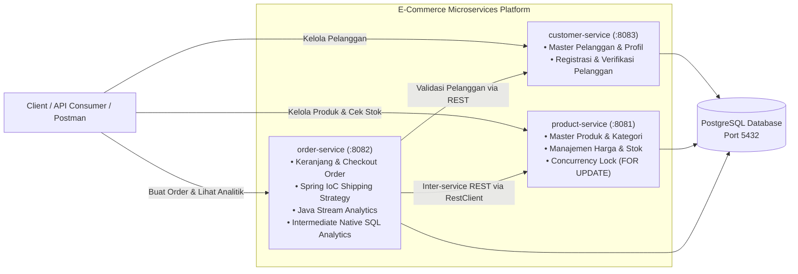

# E-Commerce Microservices

Backend platform e-commerce berbasis microservices menggunakan Java 21 dan Spring Boot.

## Arsitektur

Platform ini terdiri dari 3 service independen yang saling terintegrasi:



## Tech Stack

- **Java 21**
- **Spring Boot** (Spring Data JPA, Spring Web, RestClient)
- **PostgreSQL**
- **Docker & Docker Compose**
- **Gradle**

## Cara Menjalankan

### 1. Menggunakan Docker Compose (Rekomendasi)

Jalankan perintah berikut di direktori root:

```bash
docker compose up --build
```

Layanan akan aktif di:
- `customer-service`: http://localhost:8083
- `product-service`: http://localhost:8081
- `order-service`: http://localhost:8082
- `PostgreSQL`: localhost:5432

### 2. Menjalankan Secara Lokal (Gradle)

1. Pastikan PostgreSQL aktif pada port `5432` dengan database `ecommerce_db`.
2. Jalankan test:
   ```bash
   ./gradlew test
   ```
3. Jalankan masing-masing service di terminal terpisah:
   ```bash
   ./gradlew :customer-service:bootRun
   ./gradlew :product-service:bootRun
   ./gradlew :order-service:bootRun
   ```

## Endpoint API

### Customer Service (`:8083`)
- `GET /api/customers` - Daftar semua customer
- `GET /api/customers/{id}` - Detail customer berdasarkan ID
- `GET /api/customers/by-email?email=...` - Cari customer berdasarkan email
- `POST /api/customers` - Registrasi customer baru

### Product Service (`:8081`)
- `GET /api/products` - Daftar produk (filter opsional: `?category=ELECTRONICS`)
- `GET /api/products/{id}` - Detail produk berdasarkan ID
- `POST /api/products` - Tambah produk baru
- `GET /api/products/analytics/top-ranked` - Peringkat produk teratas per kategori
- `GET /api/products/analytics/category-counts` - Jumlah distribusi produk per kategori
- *(Internal)* `POST /api/products/{id}/reserve-stock` & `/release-stock` - Reservasi dan rollback stok (dipanggil via REST oleh `order-service`)

### Order Service (`:8082`)
- `POST /api/orders/checkout` - Checkout dan pembuatan order baru
- `GET /api/orders` - Daftar seluruh order
- `GET /api/orders/{id}` - Detail order berdasarkan ID
- `GET /api/orders/analytics/streams` - Ringkasan analitik penjualan (Java Stream)
- `GET /api/orders/analytics/best-sellers?topN=3` - Produk terlaris (Native SQL Window Function)
- `GET /api/orders/analytics/vip-customers?minOrders=1&minSpend=1000000` - Daftar customer VIP (Native SQL JOIN & HAVING)

#### Contoh Request Checkout:
```bash
curl -X POST http://localhost:8082/api/orders/checkout \
  -H "Content-Type: application/json" \
  -d '{
    "customerId": 1,
    "shippingType": "EXPRESS",
    "items": [
      { "productId": 2, "quantity": 1 },
      { "productId": 6, "quantity": 2 }
    ]
  }'
```
