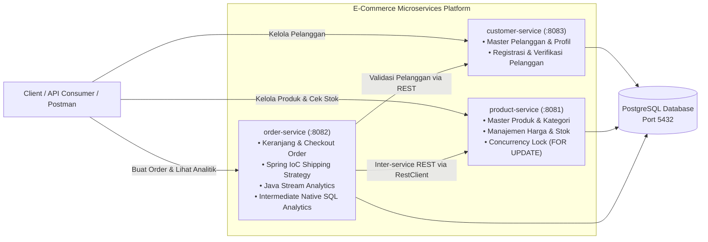

# E-Commerce Microservices Platform

Platform Microservices E-Commerce modern berbasis Java 21 dan Spring Boot yang dibangun untuk memenuhi kualifikasi teknis tingkat **Middle**:
1. **Spring IoC (Inversion of Control & Dependency Injection)**
2. **Java Stream API**
3. **Intermediate Native SQL Query**
4. **Containerization & Microservices**

---

## 1. Arsitektur Sistem

Aplikasi ini mengadopsi arsitektur Microservices dengan pembagian domain yang jelas:



### Struktur Modul:
```
.
├── build.gradle                   # Konfigurasi root multi-module Gradle
├── settings.gradle                # Definisi modul (customer-service, product-service, order-service)
├── docker-compose.yml             # Orkestrasi Docker (Postgres, Customer, Product, Order)
├── init-db.sql                    # Inisialisasi basis data PostgreSQL
├── customer-service/              # Microservice Pengelolaan Pelanggan & Profil (Port 8083)
│   ├── Dockerfile
│   ├── build.gradle
│   └── src/
├── product-service/               # Microservice Pengelolaan Produk & Stok (Port 8081)
│   ├── Dockerfile
│   ├── build.gradle
│   └── src/
└── order-service/                 # Microservice Pemrosesan Order & Analitik (Port 8082)
    ├── Dockerfile
    ├── build.gradle
    └── src/
```

---

## 2. Pemenuhan Kualifikasi Teknis (Kriteria Middle)

### A. Spring IoC (Inversion of Control & Dependency Injection)
* **Strategy Pattern via Spring IoC Container**:
  * Perhitungan ongkos kirim (*shipping fee*) dienkapsulasi ke dalam interface `ShippingStrategy`.
  * Setiap strategi didaftarkan sebagai Spring Bean:
    * `RegularShippingStrategy` (`@Component("REGULAR")`): Tarif flat Rp 10.000 / kg.
    * `ExpressShippingStrategy` (`@Component("EXPRESS")`): Layanan kilat Rp 25.000 / kg dengan minimum fee.
    * `CargoShippingStrategy` (`@Component("CARGO")`): Tarif diskon muatan berat (>= 10kg) Rp 6.000 / kg.
  * Injeksi strategi dilakukan secara otomatis ke dalam `ShippingFeeCalculator` menggunakan `Map<String, ShippingStrategy>`, tanpa hardcode pengkondisian *if-else*.
* **Custom Bean Configuration**:
  * Bean `RestClient` terkonfigurasi di `RestClientConfig` dengan timeout, interceptor header, dan base URL dinamis untuk komunikasi antar-microservice (`product-service` dan `customer-service`).
* **Constructor Injection**:
  * Seluruh dependensi kelas disuntikkan secara immutabel via constructor injection (`@RequiredArgsConstructor`).

### B. Java Stream API
Penerapan fungsional stream tingkat lanjut di `OrderAnalyticsService`:
* **`Collectors.groupingBy`**: Mengelompokkan dan menghitung jumlah pesanan berdasarkan status transaksi (`PENDING`, `COMPLETED`, `CANCELLED`).
* **`Collectors.partitioningBy`**: Memisahkan order bernilai tinggi (*High-Value Orders* >= Rp 1.000.000) dengan pesanan reguler untuk prioritas pemenuhan.
* **`Collectors.summarizingDouble`**: Mengekstrak ringkasan statistik (jumlah transaksi, total omset, nilai transaksi minimum, rata-rata, dan maksimum) secara simultan.
* **`flatMap`**: Mengurai koleksi daftar order bertingkat menjadi stream item individual untuk menghitung total kuantitas barang terjual per kategori produk.
* **`Comparator.comparing(...).thenComparing(...)`**: Multi-kriteria pengurutan transaksi berdasarkan nominal terbesar lalu tanggal transaksi terbaru.

### C. Intermediate Native SQL Query
Query SQL Native dieksekusi melalui Spring Data JPA (`nativeQuery = true`) dengan *projections*:
1. **Window Function & CTE (`WITH`) — Best Sellers per Kategori**:
   * Menghitung total barang terjual dan meranking 3 produk teratas di masing-masing kategori menggunakan `DENSE_RANK() OVER (PARTITION BY ... ORDER BY ...)`:
   * Lokasi: `OrderRepository.findBestSellerProductsPerCategory()`.
2. **Multi-Table JOIN dengan `GROUP BY` & `HAVING` — Analisis Pelanggan VIP**:
   * Melakukan join multi-tabel (`orders`, `customers`, `order_details`) dan menyaring pelanggan dengan jumlah order minimum dan total belanja di atas ambang batas:
   * Lokasi: `OrderRepository.findVipCustomers()`.
3. **Pessimistic Locking (`FOR UPDATE`) — Concurrency Control**:
   * Mengunci baris produk saat checkout untuk mencegah *race condition / overselling* saat flash sale:
   * Lokasi: `ProductRepository.findByIdForUpdate()`.

### D. Containerization & Microservices
* **3 Microservices Independen**: Masing-masing service memiliki *lifecycle*, port, dan dependencies tersendiri (`customer-service`, `product-service`, `order-service`).
* **Inter-Service Communication**: `order-service` memanggil `customer-service` untuk validasi status pelanggan dan memanggil `product-service` untuk verifikasi serta reservasi stok produk secara atomik melalui Spring Boot `RestClient`.
* **Multi-Stage Dockerfile**:
  * Menggunakan `eclipse-temurin:21-jdk-alpine` untuk kompilasi JAR.
  * Menggunakan `eclipse-temurin:21-jre-alpine` untuk image runtime yang ringan dan aman.
* **Docker Compose**:
  * Mengorkestrasi basis data PostgreSQL, `customer-service`, `product-service`, dan `order-service` lengkap dengan healthcheck dan network terisolasi.

---

## 3. Cara Menjalankan Aplikasi

### Opsi 1: Menjalankan Menggunakan Docker Compose (Direkomendasikan)
Cukup jalankan perintah berikut di direktori root project:

```bash
docker compose up --build
```
Layanan akan aktif pada:
* PostgreSQL: `localhost:5432`
* `customer-service`: `http://localhost:8083`
* `product-service`: `http://localhost:8081`
* `order-service`: `http://localhost:8082`

---

### Opsi 2: Menjalankan Secara Lokal (Gradle)

1. Pastikan database PostgreSQL berjalan (atau sesuaikan koneksi di `application.yml`).
2. Jalankan build dan test:
   ```bash
   ./gradlew test
   ```
3. Jalankan `customer-service` di terminal pertama:
   ```bash
   ./gradlew :customer-service:bootRun
   ```
4. Jalankan `product-service` di terminal kedua:
   ```bash
   ./gradlew :product-service:bootRun
   ```
5. Jalankan `order-service` di terminal ketiga:
   ```bash
   ./gradlew :order-service:bootRun
   ```

*(Catatan: Saat aplikasi pertama kali dijalankan, data seeder otomatis mengisi data awal pelanggan, produk, dan pesanan contoh sehingga seluruh endpoint langsung dapat diuji).*

---

## 4. Panduan Uji Coba Endpoint (API Testing)

### A. Customer Service (Port 8083)

1. **Melihat Semua Pelanggan**:
   ```bash
   curl -X GET http://localhost:8083/api/customers
   ```

2. **Melihat Detail Pelanggan Berdasarkan ID**:
   ```bash
   curl -X GET http://localhost:8083/api/customers/1
   ```

3. **Mencari Pelanggan Berdasarkan Email**:
   ```bash
   curl -X GET "http://localhost:8083/api/customers/by-email?email=alice.johnson@example.com"
   ```

4. **Registrasi Pelanggan Baru**:
   ```bash
   curl -X POST http://localhost:8083/api/customers \
     -H "Content-Type: application/json" \
     -d '{
       "name": "Budi Santoso",
       "email": "budi.santoso@example.com",
       "phone": "08123456789",
       "address": "Jl. Sudirman No. 10, Jakarta"
     }'
   ```

---

### B. Product Service (Port 8081)

1. **Melihat Semua Produk**:
   ```bash
   curl -X GET http://localhost:8081/api/products
   ```
2. **Melihat Produk Berdasarkan Kategori**:
   ```bash
   curl -X GET "http://localhost:8081/api/products?category=ELECTRONICS"
   ```
3. **Analitik Produk Termahal per Kategori (Native SQL Window Function)**:
   ```bash
   curl -X GET http://localhost:8081/api/products/analytics/top-ranked
   ```
4. **Distribusi Kategori Produk (Java Stream)**:
   ```bash
   curl -X GET http://localhost:8081/api/products/analytics/category-counts
   ```

---

### C. Order Service (Port 8082)

1. **Checkout Order Baru (Integrasi Customer + Product + Spring IoC Shipping Strategy)**:
   ```bash
   curl -X POST http://localhost:8082/api/orders/checkout \
     -H "Content-Type: application/json" \
     -d '{
       "customerId": 1,
       "shippingType": "EXPRESS",
       "items": [
         {
           "productId": 2,
           "quantity": 1
         },
         {
           "productId": 6,
           "quantity": 2
         }
       ]
     }'
   ```

2. **Analitik Java Stream (Grouping, Partitioning, Summary Statistics)**:
   ```bash
   curl -X GET http://localhost:8082/api/orders/analytics/streams
   ```

3. **Analitik Produk Terlaris (Intermediate Native SQL Window Function + CTE)**:
   ```bash
   curl -X GET "http://localhost:8082/api/orders/analytics/best-sellers?topN=3"
   ```

4. **Analitik Pelanggan VIP (Intermediate Native SQL JOIN + HAVING)**:
   ```bash
   curl -X GET "http://localhost:8082/api/orders/analytics/vip-customers?minOrders=1&minSpend=1000000"
   ```
